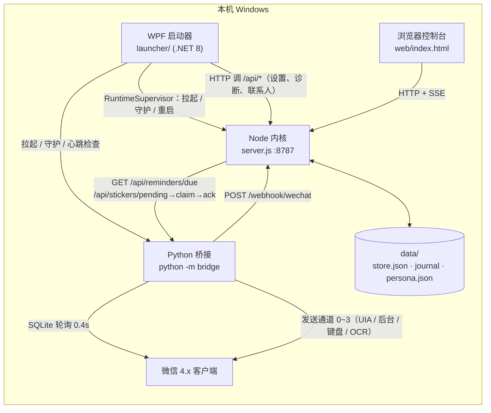
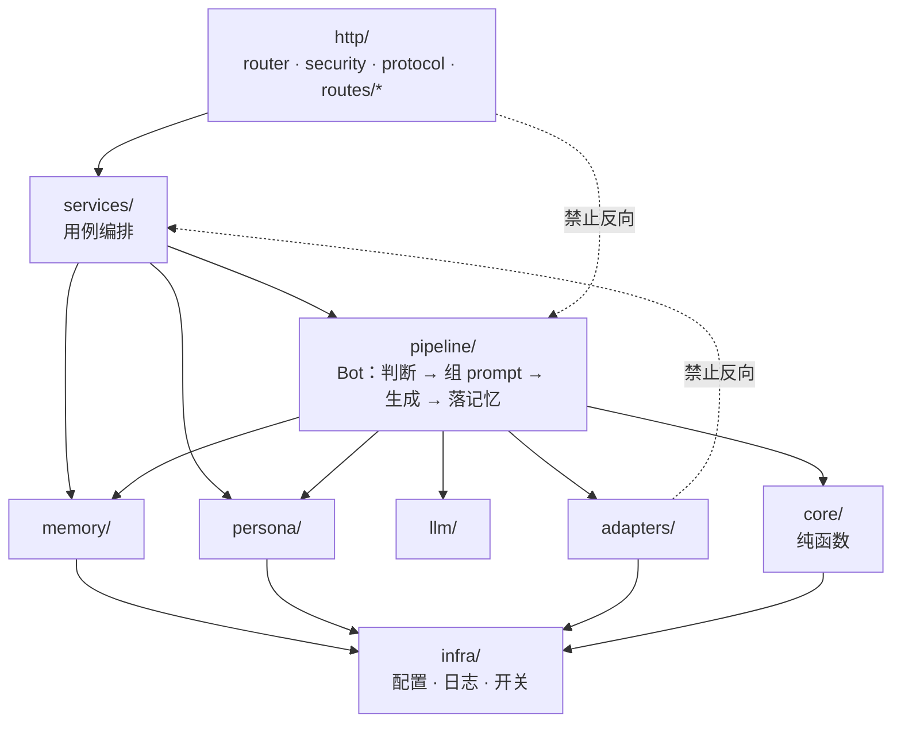
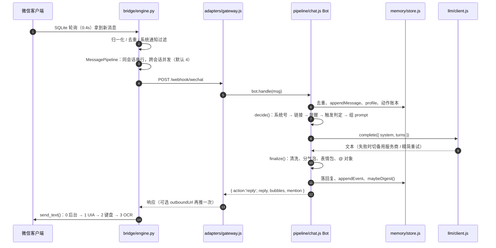

# 架构总览（代码框架）

这份文档回答三个问题：**系统由哪几块组成、一块代码该放哪、改动会牵动谁**。
`README-REFACTOR.md` 记的是「旧文件搬到了哪里」的历史账，这里记的是**当前结构**，两者冲突时以本文为准。

- 技术栈：Node.js ≥18 + CommonJS，**零 npm 依赖**；Python 3 桥接；.NET WPF 启动器
- 规模：`src/` 69 个 JS 文件，`tests/` 68 个测试文件（约 637 条用例）
- 分层规则不是口头约定：`scripts/check-layers.js` 会真的扫 `require()`，`tests/layers.test.js` 在 `node --test` 里跑

---

## 一、四个运行体

整台机器上跑着四个东西，启动器是唯一的总闸：



| 运行体 | 入口 | 职责 | 不负责 |
| --- | --- | --- | --- |
| Node 内核 | `server.js`（薄）+ `src/app.js`（装配） | 对话流程、人设、记忆、模型调用、HTTP 控制台 API | 碰微信客户端（只认 webhook） |
| Python 桥接 | `bridge/__main__.py` → `bridge/engine.py::main()` | 读微信数据库、归一化消息、发送消息、到点提醒与表情包 | 不调模型、不写记忆 |
| WPF 启动器 | `launcher/MainWindow.xaml.cs` | 进程守护、配置界面、诊断、记忆备份 | 不参与对话 |
| Web 控制台 | `web/index.html`（聊天）、`persona.html`（调教）、`debug.html`（调试） | 人可操作的界面 | 静态资源，无构建链 |

进程间只有两个契约：**HTTP** 和 **`data/` 目录里的文件**。端口写在 `data/server-port.txt`，桥接优先读它，
所以 `--port=8788` 之后桥接不会还连 8787。

---

## 二、Node 内核的十层

```
server.js            薄入口：CLI / 启动 / 自检，只有装配和进程生命周期
src/app.js           唯一的依赖注入点 createRuntime()
  ├─ core/           纯逻辑，无 IO，最容易单测
  ├─ infra/          配置、日志、功能开关、配置热更新、配置校验
  ├─ memory/         会话存储 + 增量日志 + 备份/恢复 + 摘要/召回
  ├─ llm/            模型客户端（DeepSeek / OpenAI 兼容 / Ollama / 演示模式）
  ├─ persona/        人设、语料、预设、主人调教结果
  ├─ adapters/       外部世界：网关、链接、B站、联网、视觉、媒体缓存、表情包
  ├─ pipeline/       对话主流程（Bot），stages/ 放固定话术分支
  ├─ services/       面向用例的业务服务，HTTP 层直接调用
  └─ http/           路由基础设施 + 按领域拆分的路由 + 安全闸
```



依赖方向的唯一判断标准：**这条边是往「上层 / 用例」走，还是往「IO / 外部」走**。往 IO 走可以，反向不行。

### 各层职责与禁区

| 层 | 目录 | 放什么 | 禁止依赖 | 典型文件 |
| --- | --- | --- | --- | --- |
| core | `src/core/` | 无 IO 的判定与文本处理 | adapters / services / http / pipeline / memory / llm / persona | `trigger.js`、`context.js`、`text.js`、`events.js` |
| infra | `src/infra/` | 配置加载与校验、日志、功能开关 | 无（谁都能用） | `config.js`、`configSchema.js`、`configPatch.js` |
| memory | `src/memory/` | 会话存储、增量日志、备份、摘要、召回 | pipeline / services / http / adapters | `store.js`、`digest.js`、`recall.js` |
| llm | `src/llm/` | 模型客户端、provider 切换、备用服务商 | pipeline / services / http / adapters | `client.js` |
| persona | `src/persona/` | 人设文本、别名、预设、调教结果持久化 | pipeline / services / http | `index.js`、`store.js`、`presets.js` |
| adapters | `src/adapters/` | 网关、链接抓取（含 SSRF 防护）、B站、联网搜索、视觉、媒体缓存、表情包图库 | pipeline / services / http | `gateway.js`、`links.js`、`stickers.js` |
| pipeline | `src/pipeline/` | 对话主流程与固定话术分支 | http | `chat.js`、`stages/canned.js` |
| services | `src/services/` | 供路由调用的用例编排 | `http/router`、`http/security`、`http/static`、`http/util`（协议工具走 `http/protocol`） | `status.js`、`settings.js`、`reminderService.js` |
| http | `src/http/` | 路由表、安全闸、静态文件、SSE 协议 | 无（最上层） | `router.js`、`security.js`、`routes/*.js` |

例外只有一条，写在 `check-layers.js` 的 `ALLOW` 里：`core → infra/features`（只读布尔值，无 IO）。

**新增依赖前先跑** `node scripts/check-layers.js`。违规不会等到运行时才炸，`node --test` 里也会红。

---

## 三、一条消息的完整生命周期



`decide()` → `handle()` 是主线：

| 阶段 | 位置 | 做什么 |
| --- | --- | --- |
| 归一化 | `Bot.normalize()` | 平台消息 → 统一结构（`cleanText`、`atMe`、`chatType`…） |
| 早退 | `_decide()` 前半 | 系统号、通知、重复消息、@ 别人、静默期 → `ignore` |
| 特殊分支 | `tryReminder` / `stages/canned.js` / `runCommand` | 提醒、固定话术、`/reset` `/mute` 之类，不调模型 |
| 触发判定 | `core/trigger.js` + `computeTrigger()` | 群里该不该接话：@、接话窗口、限流、自由接话 |
| 组上下文 | `core/context.js`、`memory/recall.js` | 历史 turns、群聊事件化、长度控制、压缩摘要、相关记忆 |
| 生成 | `llm/client.js` | 主服务商 → 备用服务商 → 精简上下文重试 |
| 收尾 | `finalize()` / `handle()` 尾 | 清洗、分气泡、表情包、`mention`、异步记忆整理 |

桥接侧的「收 / 判 / 发」三段固定在 `bridge/README.md` 里，调度器 `msg_pipeline.py` 不依赖 `wechatauto`，可单独自检。

---

## 四、HTTP 面

`server.js` 只做 `http.createServer` + `router.handle`；路由按领域一文件，`routes/index.js` 汇总。

| 文件 | 路径 | 用途 |
| --- | --- | --- |
| `status.js` | `GET /api/status` | 运行状态、最近发言人、回复通道 |
| `settings.js` | `GET/POST /api/settings`、`POST /api/settings/test` | 网页设置、测 Key |
| `config.js` | `GET/POST /api/config` | 调试台读写 `config.json`（整批校验） |
| `features.js` | `GET/POST /api/features` | 功能开关 |
| `persona.js` | `GET/POST /api/persona`、`/api/persona/presets`、`/api/persona/preset` | 人设调教、预设 |
| `memory.js` | `GET /api/memory/info`、`/api/memory/export`、`POST /api/memory/backup`、`/api/memory/restore`、`GET /api/memory` | 记忆浏览、快照、导出、恢复 |
| `chat.js` | `POST /api/chat`（SSE）、`POST /api/reset` | 网页聊天 |
| `wechat.js` | `GET /api/wechat/accounts`、`POST /api/wechat/account`、`/accounts/refresh`、`GET /api/wechat/contacts`、`POST /api/wechat/contacts/sync` | 多账号扫描、选账号、联系人 |
| `bridge.js` | `POST /api/bridge/heartbeat`、`GET/POST /webhook/{platform}` | 桥接心跳、网关入口（GET 用于 challenge 校验与状态） |
| `care.js` | `GET /api/care/due`、`GET /api/care` | 主动搭话到点判定 |
| `vision.js` | `POST /api/vision`、`POST /api/vision/test` | 看图与连通性测试 |
| `debug.js` | `GET /api/debug/state`、`/api/debug/sessions`、`POST /api/debug/prompt`、`/api/debug/reset` | 调试台 |
| `stickers.js` | `/api/stickers/**`（前缀路由） | 图库、分类、桥接 pending/claim/ack |
| `reminders.js` | `/api/reminders/**`（前缀路由） | 提醒列表、取消、桥接到点领取与回执 |

三道安全闸在 `src/http/security.js` 与 `src/http/protocol.js`：

1. **本机限制**：提醒、表情包管理、配置写入等只允许 loopback；
2. **桥接 token**：`/webhook/*`、`reminders/due|ack`、`stickers/pending|claim|ack` 必须带对 `gateway.wechat.inboundToken`；
3. **CSRF 与远程暴露**：浏览器跨站写请求一律拒绝；非 loopback 监听必须显式 `server.allowRemote=true`，
   远程写还要带非默认的 `x-bot-token`；所有响应带 nosniff / no-referrer / CSP 安全头。

对外多说一句：**`/webhook/{platform}` 的路径与字段属于兼容契约**，`docs/GATEWAY.md` 是权威定义，改之前先看它。

---

## 五、子域速查

### core（11 个纯逻辑模块）

| 模块 | 内容 |
| --- | --- |
| `text.js` | 敏感词清洗、群名匹配、时间格式化、文本归一化、整数收敛 |
| `identity.js` | 剔除「她否认主人」的历史片段 |
| `echo.js` | 复读检测 |
| `facts.js` | 从「我…」自述里抽长期事实 |
| `mentions.js` | 提取 @ 对象 |
| `commands.js` | `/reset`、`/mute`、`记住…` 等小命令解析 |
| `trigger.js` | 群聊触发判断（@、接话窗口、静默期、限流、自由接话） |
| `context.js` | 历史消息 → 模型 turns（事件化、长度控制、压缩摘要） |
| `events.js` | 动作账本：表情包 / 发送 / 读链接 / 联网四类外部动作 |
| `master.js` | 主人识别（`persona.master.names` / `wxids`），调试台预览与微信里共用同一函数 |
| `reminder.js` | 「十点半提醒我开会」这类自然语言时间的解析 |

### memory

`store.js` 是核心（会话、消息、画像、笔记、事件、去重、清理）；
`data/store.json` 是快照、`data/store.json.journal` 是增量，统一用 `readStoreFile()` 合并——备份、导出、重载都走它。
`digest.js`（摘要 + 抽事实）、`recall.js`（关键词/语义召回）、`semantic.js`、`forget.js`、`backup.js` 都是它的卫星模块。

### llm

`client.js` 一个类覆盖四类 provider：DeepSeek、OpenAI 兼容（千问/智谱等）、Ollama、演示模式（`isMock`）。
Key 缺失自动降级为演示模式，`switchFallback()` 供 `Bot` 在主服务商 401/429/404 时切换。

### adapters

`gateway.js` 是通用 HTTP 网关：收 `POST /webhook/{platform}` 并归一化，发 `POST {gateway.outboundUrl}`；`links.js` 带 SSRF 防护；`websearch.js` 含天气；
`stickers.js` 是图库与上传校验；`mediaCache.js` 负责缓存清理。

### 数据文件

```
config.json              配置（config.example.json 是模板，docs/设置说明.md 是字段字典）
data/store.json          会话快照
data/store.json.journal  增量日志
data/persona.json        主人调教结果（语态 / 能力）
data/settings.json       网页设置的覆盖层
data/reminders.json      提醒
data/sticker-categories.json 表情包分类
data/whale.log           Node 日志
data/logs/run-<时间>/    启动器每次运行的日志（launcher.log）
data/server-port.txt     实际监听端口（桥接读它）
```

---

## 六、启动器与 Web 控制台

- **launcher**（WPF，.NET 8）：`Views/` 下每页一 XAML + code-behind
  —— 状态、桥接、记忆、人设、表情包、提醒、诊断、设置。
  `RuntimeSupervisor.cs` 管进程生命周期；`Api.cs` 是调用 `:8787` 的薄客户端；
  所有页面继承 `IRefreshable`，由主窗口统一驱动刷新。
- **web**：无构建链的静态页（`assets/app.js` + `style.css`）。
  `index.html` 聊天、`persona.html` 调教台、`debug.html` 调试台，
  调接口只认 `fetch`，不引第三方框架。

---

## 七、新代码放哪里

按问题性质对照，别按文件大小：

| 你要做的事 | 放这里 | 顺手要做的 |
| --- | --- | --- |
| 一句正则/一个判定，不需要读盘 | `src/core/` | 补 `tests/*.test.js`，纯函数最省事 |
| 新增一个外部系统（API、命令行工具） | `src/adapters/` | 失败要可降级，不要在 adapter 里抛给 pipeline |
| 新增一个用户可感知的用例（导出、补偿、清理） | `src/services/` | 路由只做解析参数与返回 |
| 改对话流程、prompt 组装、触发条件 | `src/pipeline/`（能抽纯函数就抽到 `core/`） | 跑全量测试，`bot.test.js` 是主回归 |
| 加一个 HTTP 端点 | `src/http/routes/` 新领域文件 + `routes/index.js` 注册 | 决定是否需要本机限制 / 桥接 token |
| 加一个配置项 | `src/infra/config.js` + `configSchema.js` + `config.example.json` | 同步 `docs/设置说明.md` |
| 加一个桥接能力（读消息、发文件） | `bridge/` | 保持 `msg_pipeline.py` 不依赖 wechatauto |
| 加一个界面页 | `launcher/Views/` 或 `web/` | 启动器记得继承 `IRefreshable` |

三条硬规则：

1. 业务代码不新起单例，依赖从 `createRuntime()` 注入；
2. 新增的 `require` 先想清楚方向，再跑 `npm run check-layers`；
3. 对外契约（REST 路径、webhook 字段、`config.json` 结构、`.bat` 启动方式）不动，除非有版本迁移。

---

## 八、已知边界与技术债

| 位置 | 现状 | 方向 |
| --- | --- | --- |
| `pipeline/chat.js::_decide()` | 约 450 行，触发判定 / 引用 / 拼 prompt 混在一起 | 按 `stages/` 的方式一批一批搬，每批全量测试 |
| `bridge/engine.py::main()` | 约 2100 行闭包 | 拆分顺序写在 `bridge/README.md`，先拆无副作用模块 |
| `bridge/engine.py` | 单文件 18 万字节 | 同上，`config` → `wechat_db` → `logging/guards` → `window/sender/receiver` |
| `web/` | 无构建、无模块化 | 改动小就维持现状，别为它引 npm |

## 九、验证命令

```bash
node server.js --doctor        # 环境自检
node --test "tests/*.test.js"  # 全量测试（不要加 --test-isolation=none）
node scripts/check-layers.js   # 分层依赖
npm run smoke                  # 冒烟（PowerShell）
```
